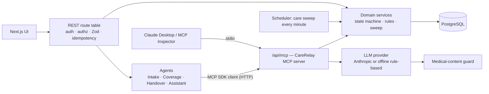

# CareRelay

**No missed care. No ambiguous responsibility. No broken handovers.**

CareRelay is an MCP-powered care-coordination and failure-prevention system for families looking after someone at home. Every care task has an owner who has explicitly **accepted** it, a time window, and a completion record. A deterministic gap-detection engine (plus a narrowly scoped AI layer) finds the places where care silently falls through — nobody owns the evening dose, two people both gave it, the new prescription disagrees with the old one, the night attendant never got a handover — explains why, shows the evidence, and routes it to the person who has to act. AI agents work **only** through real MCP tools, and CareRelay never gives medical advice.

> Built for the *Make MCP Matter — Less Magic, More Utility* track. Synthetic demo data only — not medical guidance.

---

## The 10 scenarios → features → rules

The original problem statement was not available to the team; scenario names come from the build brief (see `docs/DECISIONS.md`).

| # | Scenario | What CareRelay does | Rule / mechanism |
|---|---|---|---|
| 1 | Assumption gap | Unowned high-priority task near its window raises an alert; assignment ≠ acceptance; alert clears only when the owner accepts | `GAP-001`, `GAP-002`, state machine |
| 2 | Duplicate administration | Second record shows the first (who, when), never advises on dosing, stores a `DISPUTED` record + conflict; original unchanged | `DUP-001`, partial unique index |
| 3 | Prescription conflict | New version is extracted as proposals, diffed field-by-field against active instructions; nothing changes until a clinical verifier approves; old version kept | `CON-002`, ApprovalRequest |
| 4 | Incomplete handover | Shift ends without a handover (or it isn't read) → alert; structured snapshot + cited AI summary; "I have read this" doesn't accept tasks | `HND-001` |
| 5 | Inventory shortage | Projection from verified count − recorded use; estimate labelling; alert until someone *accepts* the refill | `INV-001`, `INV-002` |
| 6 | Caregiver unavailable | Declared unavailability / simulated calendar overlaps an assigned window → alert; Coverage Agent proposes qualified, free people via MCP | `GAP-005`, qualification guard |
| 7 | Contradictory reports | "Given" record vs. later "she hasn't had it" message (AI-interpreted) → conflict, side-by-side view | `CON-001` (+ AI semantic layer) |
| 8 | Silent failure | Window passes with no record → `OVERDUE`, then escalation per policy (in-app → coordinators → voice) | `GAP-003`, escalation policy |
| 9 | Post-discharge extraction | Discharge papers → proposals with highlighted source spans → verifier approval → tasks generated | Intake Agent, `extract_from_document` |
| 10 | Remote family view | Remote viewer sees consolidated status only; messages/documents return 403 | `authz.ts`, `REMOTE_VIEWER` |

Also: `GAP-004` (transfer / hand-off not accepted, including AI-detected "Ravi will give it" with no confirmation from Ravi) and `CON-003` (appointment scheduled vs. cancelled across sources).

## Architecture



Details: `docs/ARCHITECTURE.md`, `docs/SCHEMA.md`, `docs/STATE_MACHINE.md`, `docs/AUTHZ.md`, `docs/API.md`, `docs/MCP_TOOLS.md`, `docs/AGENTS.md`, `docs/ACCEPTANCE_TESTS.md`, `docs/DECISIONS.md`.

Repository layout: `apps/web` (Next.js UI + REST + `/api/mcp`), `packages/domain` (state machine, rules, services, authz, clock), `packages/mcp-server` (tools, resources, prompt; stdio + HTTP), `packages/agents` (agents, LLM providers, guard, extraction), `packages/demo` (synthetic seed), `prisma` (schema, migrations, seed), `tests` (unit, integration, e2e), `docs`.

## MCP

17 tools, 2 resources (`patient://{id}/timeline`, `document://{id}`) and 1 prompt (`shift_handover`). Every call is authenticated, patient-scoped, permission-checked, Zod-validated and written to the append-only audit log (visible live in **Assistant & MCP**).

| Class | Tools |
|---|---|
| READ | `list_patients`, `get_care_status`, `list_tasks`, `get_task`, `list_open_alerts`, `get_source_reference`, `get_member_availability`, `find_available_caregivers`, `get_inventory_status` |
| PROPOSE (never commits) | `draft_handover`, `extract_from_document`, `extract_from_message`, `propose_reassignment`, `request_approval` |
| ACT_SELF | `acknowledge_task`, `record_observation` |
| READ + system | `run_care_sweep` (idempotent) |

### Connect Claude Desktop (stdio)

After seeding with `DEMO_MODE=true`, each demo user has an MCP token `crt_demo_<user>_0000000000000000000000` (e.g. `crt_demo_ravi_…`). Add to `claude_desktop_config.json` (use your absolute repo path):

```json
{
  "mcpServers": {
    "carerelay": {
      "command": "pnpm",
      "args": ["--silent", "--dir", "/absolute/path/to/CareRelay", "mcp:stdio"],
      "env": { "CARERELAY_MCP_TOKEN": "crt_demo_ravi_0000000000000000000000" }
    }
  }
}
```

`--silent` matters: without it pnpm prints a banner to stdout and corrupts the JSON-RPC stream. Database settings come from the repo's `.env`. Quick check without Claude: `pnpm mcp:smoke` (spawns the stdio server with the SDK's stdio client and calls three tools).

Try the token of `arjun` (remote viewer) and ask Claude for a message excerpt — the tool call is denied by the same authorisation rules the app uses.

### MCP Inspector

```bash
CARERELAY_MCP_TOKEN=crt_demo_priya_0000000000000000000000 npx @modelcontextprotocol/inspector pnpm --silent mcp:stdio
```

HTTP clients: `POST http://localhost:3000/api/mcp` with `Authorization: Bearer <token>` (Streamable HTTP, stateless). The app issues short-lived, patient-scoped tokens to its own agents automatically.

## Integration status

| Integration | Status | Notes |
|---|---|---|
| WhatsApp / SMS messaging | **SIMULATED** | In-app simulated inbox; WhatsApp "Export chat" `.txt` import is parsed locally (real format). No messages are sent anywhere. |
| Calendar | **SIMULATED** | Seeded busy blocks marked "simulated calendar" + manual "I'm unavailable" declarations. No ICS import. |
| Pharmacy | Not integrated | Refills are recorded in CareRelay; no ordering. |
| Document text extraction | **LIVE (local)** | PDFs with a text layer via `unpdf`; plain text. **No image OCR** — paste/type text for photos. |
| LLM | **LIVE** if `ANTHROPIC_API_KEY` is set (default model `claude-opus-5-5`, server-side refusal fallbacks enabled), otherwise **offline rule-based provider** | Header badge shows which. The demo and all tests run on the offline provider. |
| ElevenLabs voice | **LIVE** only if `ELEVENLABS_API_KEY` is set | "Listen to handover" and voice escalation alerts; audio cached per version. Hidden without a key. *Not exercised by the automated tests (no key in this environment).* |
| AWS S3 storage | Optional adapter | `STORAGE_PROVIDER=s3` + `S3_BUCKET`, `AWS_REGION`. Compiles; not exercised against a real bucket by the team. Nothing is deployed to AWS by this repo. |

## Safety boundaries (enforced in code, with tests)

- **Medical-content guard** (`packages/agents/src/guard.ts`): clinical questions are refused and any AI output advising a dose/skip/repeat/change, a diagnosis, or which instruction is correct is replaced with *"This needs a decision from an authorised person (doctor / care lead). CareRelay can't advise on this."*
- **Extracted instructions never auto-activate**: they stay `PROPOSED`/`AWAITING_VERIFICATION` until a `verify_medical` user approves an `ApprovalRequest` (who/when/source recorded).
- **Duplicate administration**: warns, shows the existing record, asks for human verification; never says whether to give another dose.
- **Coordination risk ≠ clinical severity**: alert levels are labelled "Coordination risk".
- **Not an emergency service**: persistent footer + onboarding notice ("…call your local emergency number (112 in India)").
- **Patient isolation**: every REST route and MCP tool resolves membership server-side; non-members get 404, missing permissions 403.
- **Communications privacy**: only messages explicitly authorised for processing reach AI; remote viewers never see raw messages unless granted via approval.
- **Audit**: every state change, approval, extraction, MCP tool call and escalation is in an append-only `AuditLog` (DB trigger blocks UPDATE/DELETE).

## Local setup

Requires Node ≥ 18.18, pnpm 9, Docker.

```bash
pnpm i
cp .env.example .env        # defaults work as-is
docker compose up -d        # Postgres 16 (+ carerelay_test database)
pnpm db:migrate
pnpm db:seed
pnpm dev                    # http://localhost:3000
```

Tests: `pnpm test` (unit + integration; uses `TEST_DATABASE_URL`), `pnpm test:e2e` (Playwright; starts its own server on :3100 against the test database). Also `pnpm typecheck`, `pnpm lint`.

### Demo accounts (Demo Mode only)

Password `carerelay-demo` for all; demo logins are rejected unless `DEMO_MODE=true`. The login page also offers one-click sign-in, and the demo bar has a user switcher.

| Email | Person | Role |
|---|---|---|
| priya@demo.carerelay.local | Priya (daughter) | Patient representative |
| ravi@demo.carerelay.local | Ravi (son) | Family caregiver |
| meena@demo.carerelay.local | Meena (day attendant, wound-care trained) | Professional caregiver |
| suresh@demo.carerelay.local | Suresh (night attendant, wound-care trained) | Professional caregiver |
| arjun@demo.carerelay.local | Arjun (grandson, Pune) | Remote viewer |
| clinic@demo.carerelay.local | Dr. Nair's clinic coordinator | Clinical verifier |
| kavya@demo.carerelay.local | Kavya (different patient "Appa") | Used to prove isolation |

Demo Mode adds a virtual clock (+15 min, +1 h, jump to 08:00/13:00/20:00), **Run sweep now**, **Reset demo data**, a user switcher and a **Scenario launcher** (10 scenarios, set up through the real services). Walkthrough: `docs/DEMO_SCRIPT.md`.

## Deployment

Generic: any Node 20 host + PostgreSQL 16. Build with `pnpm build`, run `pnpm db:migrate` then `pnpm start` with `DATABASE_URL`, `APP_URL` (public URL — agents call `${APP_URL}/api/mcp`), `DEMO_MODE=false`, `SCHEDULER_ENABLED=true`. Run a single app instance (the scheduler is in-process; sweeps are idempotent and serialised per patient with an advisory lock, so a second instance is safe but redundant).

AWS path (documented, not deployed by the team): App Runner or ECS Fargate for the Next.js container, RDS PostgreSQL 16 for the database, S3 for documents/audio (`STORAGE_PROVIDER=s3`), Secrets Manager for `ANTHROPIC_API_KEY` / `ELEVENLABS_API_KEY`.

## Known limitations

- Problem statement not provided; scenarios follow the build brief.
- Recurrence is "daily at fixed times" only (no RRULE). Timezones via `Intl`; seed is Asia/Kolkata.
- No image OCR; no real WhatsApp/SMS/calendar/pharmacy integrations (simulated, badged).
- Members added via approval get an account without a usable password (no invite/reset flow).
- The offline AI provider is regex-based and tuned to the synthetic seed documents/messages; real-world free text needs the live model.
- "Listen to handover" reads the English summary; no translation to the patient's preferred language.
- ElevenLabs and S3 adapters are implemented but untested against live services in this environment.
- Single-node scheduler; no push notifications outside the app.

## Roadmap

ICS calendar import; image OCR (Tesseract.js); real messaging connectors with explicit consent flows; invite/password-reset flow; per-member notification channels; translation for voice handovers.

## Licence

MIT — see `LICENSE`.
