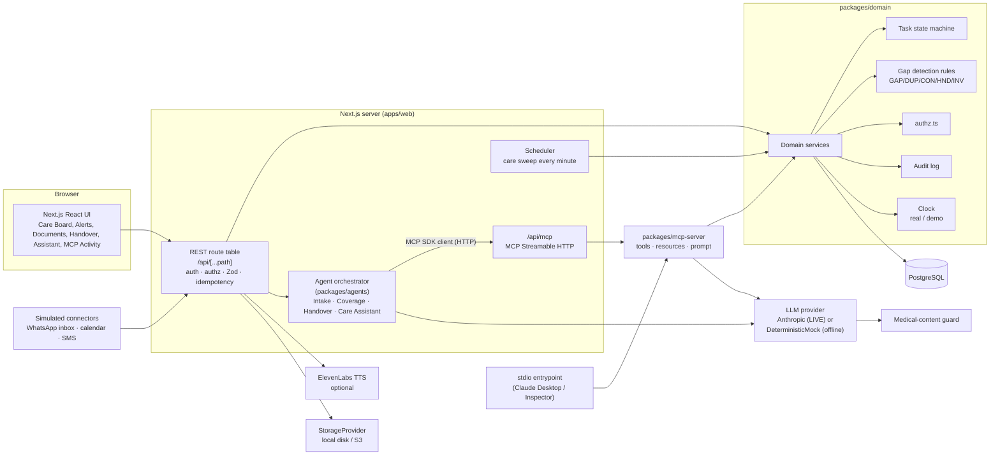
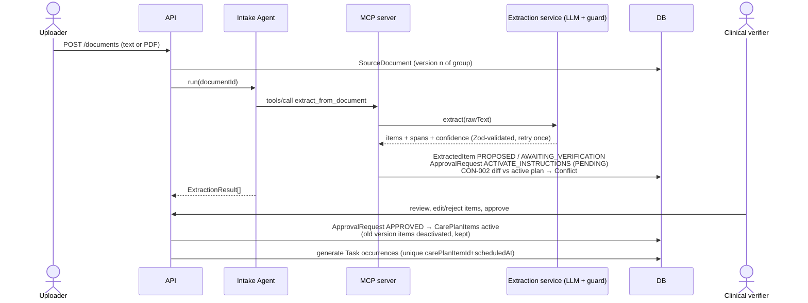

# Architecture

Key point: the agents never import domain services. They only see data through MCP tools, which call the same domain services as the REST API.

## Document upload → extraction → verification → tasks

