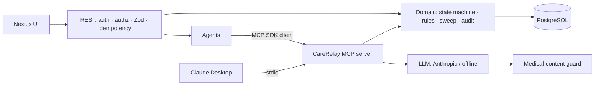

# Pitch notes (paste into the PPT template)

## Problem
Home care for an elderly parent is spread across siblings, paid attendants, clinics and a WhatsApp group. Care fails silently in the gaps: everyone assumes someone else is giving the evening dose; two people give the same dose; a revised prescription sits in a chat while the old schedule continues; the night attendant starts without a handover; medicine runs out because nobody owned the refill. Reminder apps don't fix this — the failure is **ambiguous responsibility**, not forgetting.

## Solution
CareRelay makes every care responsibility explicit and verifiable: **who owns it, did they accept it, is it done, and how do we know?**
- Tasks generated only from *verified* instructions; assignment ≠ acceptance.
- A care-gap engine (12 deterministic rules + a narrow AI layer) detects unowned tasks, unaccepted transfers, unavailability clashes, duplicate administrations, contradictory reports, prescription version changes, missing handovers, low stock and silent failures.
- Every alert explains itself: rule or AI basis, evidence with links to the original message/document span, affected task, responders, and one-click resolution actions. Escalates on a policy.
- Agents (Intake, Coverage, Handover, Care Assistant) help — but only by calling MCP tools, and they can only propose.

## Technical Blueprint

TypeScript monorepo · Next.js 15 · Prisma/PostgreSQL · official MCP TypeScript SDK (stdio + Streamable HTTP) · Zod everywhere · Vitest + Playwright.
Concurrency: optimistic locking on every mutation, Idempotency-Key replay, partial unique indexes (one recorded administration per occurrence; one open alert per dedupe key), append-only audit/event tables enforced by DB triggers.

## MCP Usage
- 17 tools in three side-effect classes — READ, PROPOSE (never commits), ACT_SELF (only your own tasks) — plus resources (`patient://…/timeline`, `document://…`) and a `shift_handover` prompt.
- Same domain services as the REST API: no duplicated logic. Per-user, patient-scoped, short-lived tokens; the server applies that user's permissions.
- The in-app agents are MCP clients over HTTP; judges can plug Claude Desktop in over stdio with a demo token and hit the same authorisation wall.
- Every call (tool, caller, patient, argument hash, outcome, duration) is audited and shown live in the MCP Activity panel.

## Safety & Privacy
- Never diagnoses, prescribes, or advises on doses; a tested guard rewrites any such output to "This needs a decision from an authorised person (doctor / care lead)."
- Extracted instructions never auto-activate — a clinical verifier approves, with who/when/source recorded.
- Alert levels are *coordination risk*, not clinical severity. Persistent "not an emergency service — call 112" notice.
- Server-side patient isolation (404 for non-members), role permissions (403), remote family members see status only; only explicitly authorised messages are processed.

## Progress So Far
Working MVP (run it: `docker compose up -d && pnpm db:migrate && pnpm db:seed && pnpm dev`):
- All 12 rules, task state machine (13 states), sweep + escalation, explainability drawer, approvals, documents with span highlighting + version diff, simulated inbox + WhatsApp export import, handovers, inventory projection, timeline, care circle, Care Assistant, MCP Activity, Demo Mode with 10-scenario launcher.
- Automated tests (all passing on 24 Nov): 162 unit tests (state machine — every transition, all 12 rules, inventory projection, prescription diff, medical-content guard with adversarial prompts, AI output schemas), 31 integration tests against PostgreSQL (concurrency, idempotency, sweep dedupe, cross-patient isolation in REST and MCP, MCP via the official SDK client, extraction → verification, reassignment acceptance/escalation, handover), 6 Playwright end-to-end tests of the flagship scenarios.

## What's Simulated vs Live
| | Status |
|---|---|
| WhatsApp/SMS inbox, calendar busy blocks | SIMULATED (badged in UI) |
| WhatsApp chat-export import, PDF text extraction | LIVE, local parsing |
| LLM | LIVE with `ANTHROPIC_API_KEY`, otherwise offline rule-based (demo default) |
| ElevenLabs voice (handover "Listen", voice escalation) | LIVE: handover audio verified end to end on 24 Nov; hidden without a key |
| AWS (App Runner + RDS + S3) | Dockerfile and deployment guide ready; deploying on hack day |
| Pharmacy ordering, image OCR | Not built |
