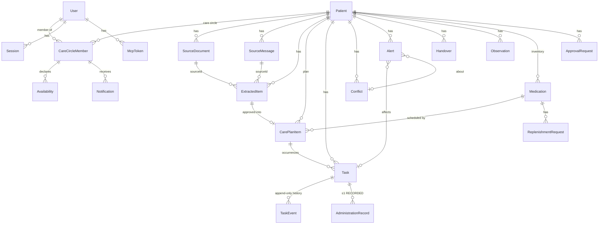

# Schema

Source of truth: `prisma/schema.prisma`. DB-level guarantees added in `prisma/migrations/*_constraints/migration.sql`:

- `AdministrationRecord`: partial unique index — one `RECORDED` row per `taskId`.
- `Alert`: partial unique index on `dedupeKey` where `state <> 'RESOLVED'`.
- `Conflict`: partial unique index on `dedupeKey` where `state = 'OPEN'`.
- `Task`: unique `(carePlanItemId, scheduledAt)`; check `windowStart <= windowEnd`.
- `Medication`: check `unitsPerAdministration > 0`.
- `TaskEvent`, `AuditLog`: triggers reject `UPDATE`/`DELETE` (append-only).
- `Availability`: check `start < end`.

Mutable aggregates (`Patient`, `CareCircleMember`, `CarePlanItem`, `Task`, `Conflict`, `Alert`, `Handover`, `Medication`, `ReplenishmentRequest`, `ApprovalRequest`, `EscalationPolicy`) carry a `version` for optimistic locking.
