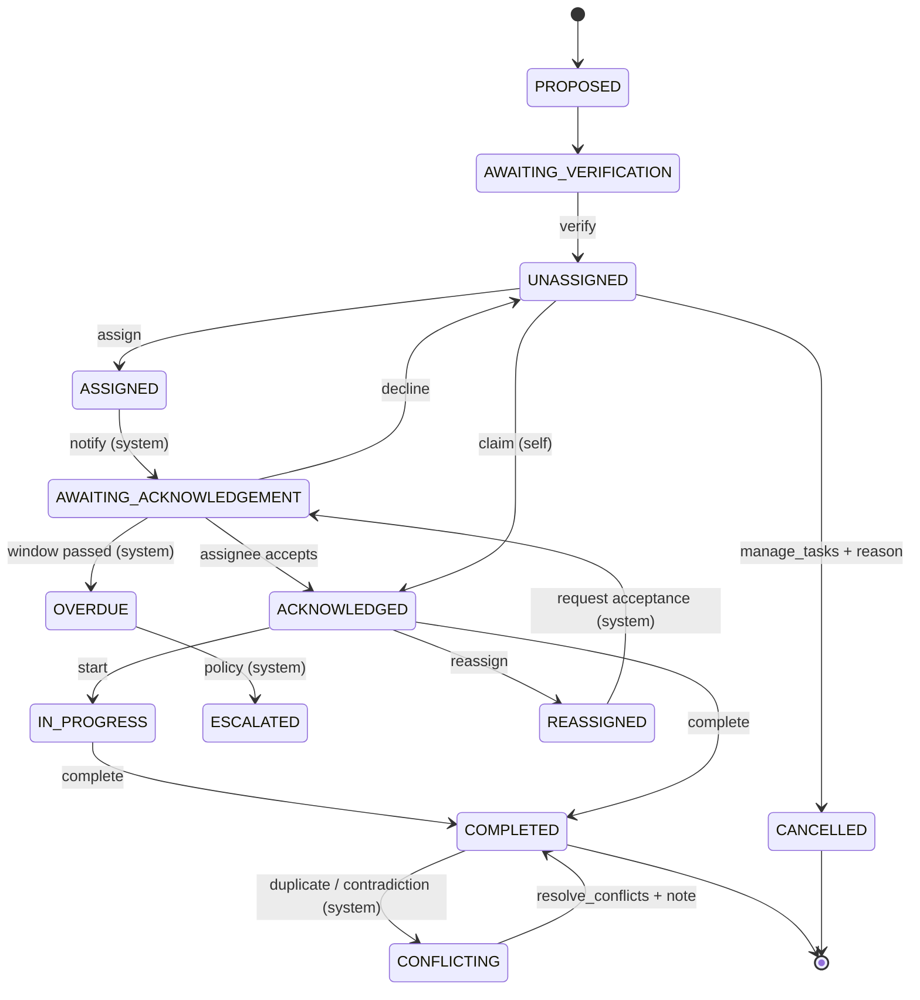

# Task state machine

Generated from `packages/domain/src/taskStateMachine.ts` by `scripts/gen-docs.ts`. Every state change (REST, MCP, scheduler) calls `planTransition`.
Invalid transitions → HTTP 409 `INVALID_TRANSITION`; missing permission → 403; failed guard → 409 `GUARD_FAILED`; stale `version` → 409 `STALE_VERSION`.

(The diagram shows the main paths; the table below is complete.)

Actor rules: **system** = scheduler/rules only; **assigneeOnly** = the assigned member themselves; **assigneeOrDeclaration** = assignee, or any `record_care` member who writes a declaration; **declarationRequired** = `record_care` + declaration; **self** = claim for yourself (`record_care`).

| From | Event | To | Actor | Guards | Meaning |
|---|---|---|---|---|---|
| PROPOSED | SUBMIT_FOR_VERIFICATION | AWAITING_VERIFICATION | system | — | Proposed task queued for human verification |
| AWAITING_VERIFICATION | VERIFY | UNASSIGNED | `verify_medical` (medical) / `manage_tasks` | — | Verified by an authorised person; now needs an owner |
| UNASSIGNED | ASSIGN | ASSIGNED | `manage_tasks` | qualification | Assigned (not yet accepted) |
| OVERDUE | ASSIGN | ASSIGNED | `manage_tasks` | qualification, noCurrentAssignee | Overdue uncovered task assigned |
| ESCALATED | ASSIGN | ASSIGNED | `manage_tasks` | qualification, noCurrentAssignee | Escalated uncovered task assigned |
| ASSIGNED | NOTIFY | AWAITING_ACKNOWLEDGEMENT | system | — | Assignee notified; waiting for them to accept |
| ASSIGNED | ACKNOWLEDGE | ACKNOWLEDGED | assigneeOnly | — | Assignee accepted the task |
| AWAITING_ACKNOWLEDGEMENT | ACKNOWLEDGE | ACKNOWLEDGED | assigneeOnly | — | Assignee accepted the task |
| ESCALATED | ACKNOWLEDGE | ACKNOWLEDGED | assigneeOnly | hasAssignee | Assignee accepted after escalation |
| UNASSIGNED | CLAIM | ACKNOWLEDGED | self | qualification, noCurrentAssignee | Caregiver took ownership (claiming is acceptance) |
| OVERDUE | CLAIM | ACKNOWLEDGED | self | qualification, noCurrentAssignee | Caregiver took ownership of an overdue task |
| ESCALATED | CLAIM | ACKNOWLEDGED | self | qualification, noCurrentAssignee | Caregiver took ownership of an escalated task |
| ASSIGNED | DECLINE | UNASSIGNED | assigneeOnly | reasonRequired | Assignee can't do it; task is uncovered again |
| AWAITING_ACKNOWLEDGEMENT | DECLINE | UNASSIGNED | assigneeOnly | reasonRequired | Assignee can't do it; task is uncovered again |
| ACKNOWLEDGED | DECLINE | UNASSIGNED | assigneeOnly | reasonRequired | Assignee can no longer do it; task is uncovered again |
| ACKNOWLEDGED | START | IN_PROGRESS | assigneeOrDeclaration | — | Work started |
| IN_PROGRESS | COMPLETE | COMPLETED | assigneeOrDeclaration | — | Completed |
| ACKNOWLEDGED | COMPLETE | COMPLETED | assigneeOrDeclaration | — | Completed |
| OVERDUE | COMPLETE | COMPLETED | assigneeOrDeclaration | — | Completed late (overdue alert stays in history) |
| ESCALATED | COMPLETE | COMPLETED | assigneeOrDeclaration | — | Completed after escalation |
| UNASSIGNED | COMPLETE | COMPLETED | declarationRequired | — | Completed by someone who declares they did it |
| ASSIGNED | COMPLETE | COMPLETED | declarationRequired | — | Completed with a declaration |
| AWAITING_ACKNOWLEDGEMENT | COMPLETE | COMPLETED | declarationRequired | — | Completed with a declaration |
| UNASSIGNED | MARK_OVERDUE | OVERDUE | system | — | Window passed with no completion record (silent failure) |
| ASSIGNED | MARK_OVERDUE | OVERDUE | system | — | Window passed with no completion record (silent failure) |
| AWAITING_ACKNOWLEDGEMENT | MARK_OVERDUE | OVERDUE | system | — | Window passed with no completion record (silent failure) |
| ACKNOWLEDGED | MARK_OVERDUE | OVERDUE | system | — | Window passed with no completion record (silent failure) |
| IN_PROGRESS | MARK_OVERDUE | OVERDUE | system | — | Window passed with no completion record (silent failure) |
| REASSIGNED | MARK_OVERDUE | OVERDUE | system | — | Window passed with no completion record (silent failure) |
| UNASSIGNED | FLAG_CONFLICT | CONFLICTING | system | — | Contradictory reports or duplicate records detected |
| ASSIGNED | FLAG_CONFLICT | CONFLICTING | system | — | Contradictory reports or duplicate records detected |
| AWAITING_ACKNOWLEDGEMENT | FLAG_CONFLICT | CONFLICTING | system | — | Contradictory reports or duplicate records detected |
| ACKNOWLEDGED | FLAG_CONFLICT | CONFLICTING | system | — | Contradictory reports or duplicate records detected |
| IN_PROGRESS | FLAG_CONFLICT | CONFLICTING | system | — | Contradictory reports or duplicate records detected |
| REASSIGNED | FLAG_CONFLICT | CONFLICTING | system | — | Contradictory reports or duplicate records detected |
| OVERDUE | FLAG_CONFLICT | CONFLICTING | system | — | Contradictory reports or duplicate records detected |
| ESCALATED | FLAG_CONFLICT | CONFLICTING | system | — | Contradictory reports or duplicate records detected |
| COMPLETED | FLAG_CONFLICT | CONFLICTING | system | — | Contradictory reports or duplicate records detected |
| CONFLICTING | RESOLVE_CONFLICT | COMPLETED | `resolve_conflicts` | reasonRequired | Conflict resolved by a human; task set to COMPLETED |
| CONFLICTING | RESOLVE_CONFLICT | ACKNOWLEDGED | `resolve_conflicts` | reasonRequired | Conflict resolved by a human; task set to ACKNOWLEDGED |
| CONFLICTING | RESOLVE_CONFLICT | UNASSIGNED | `resolve_conflicts` | reasonRequired | Conflict resolved by a human; task set to UNASSIGNED |
| CONFLICTING | RESOLVE_CONFLICT | CANCELLED | `resolve_conflicts` | reasonRequired | Conflict resolved by a human; task set to CANCELLED |
| UNASSIGNED | ESCALATE | ESCALATED | system | — | Escalated according to the escalation policy |
| ASSIGNED | ESCALATE | ESCALATED | system | — | Escalated according to the escalation policy |
| AWAITING_ACKNOWLEDGEMENT | ESCALATE | ESCALATED | system | — | Escalated according to the escalation policy |
| OVERDUE | ESCALATE | ESCALATED | system | — | Escalated according to the escalation policy |
| REASSIGNED | ESCALATE | ESCALATED | system | — | Escalated according to the escalation policy |
| ASSIGNED | REASSIGN | REASSIGNED | `manage_tasks` | qualification, differentAssignee | Responsibility transferred; not covered until the new member accepts |
| AWAITING_ACKNOWLEDGEMENT | REASSIGN | REASSIGNED | `manage_tasks` | qualification, differentAssignee | Responsibility transferred; not covered until the new member accepts |
| ACKNOWLEDGED | REASSIGN | REASSIGNED | `manage_tasks` | qualification, differentAssignee | Responsibility transferred; not covered until the new member accepts |
| OVERDUE | REASSIGN | REASSIGNED | `manage_tasks` | qualification, differentAssignee | Responsibility transferred; not covered until the new member accepts |
| ESCALATED | REASSIGN | REASSIGNED | `manage_tasks` | qualification, differentAssignee | Responsibility transferred; not covered until the new member accepts |
| REASSIGNED | REQUEST_ACCEPTANCE | AWAITING_ACKNOWLEDGEMENT | system | — | New assignee asked to accept |
| PROPOSED | CANCEL | CANCELLED | `manage_tasks` | reasonRequired | Cancelled with a reason |
| AWAITING_VERIFICATION | CANCEL | CANCELLED | `manage_tasks` | reasonRequired | Cancelled with a reason |
| UNASSIGNED | CANCEL | CANCELLED | `manage_tasks` | reasonRequired | Cancelled with a reason |
| ASSIGNED | CANCEL | CANCELLED | `manage_tasks` | reasonRequired | Cancelled with a reason |
| AWAITING_ACKNOWLEDGEMENT | CANCEL | CANCELLED | `manage_tasks` | reasonRequired | Cancelled with a reason |
| ACKNOWLEDGED | CANCEL | CANCELLED | `manage_tasks` | reasonRequired | Cancelled with a reason |
| IN_PROGRESS | CANCEL | CANCELLED | `manage_tasks` | reasonRequired | Cancelled with a reason |
| OVERDUE | CANCEL | CANCELLED | `manage_tasks` | reasonRequired | Cancelled with a reason |
| CONFLICTING | CANCEL | CANCELLED | `manage_tasks` | reasonRequired | Cancelled with a reason |
| ESCALATED | CANCEL | CANCELLED | `manage_tasks` | reasonRequired | Cancelled with a reason |
| REASSIGNED | CANCEL | CANCELLED | `manage_tasks` | reasonRequired | Cancelled with a reason |

Concurrency: every mutation is `UPDATE … WHERE id = ? AND version = ?` and increments `version`. Every mutating request carries `Idempotency-Key`; replays return the stored response and write no new event.
